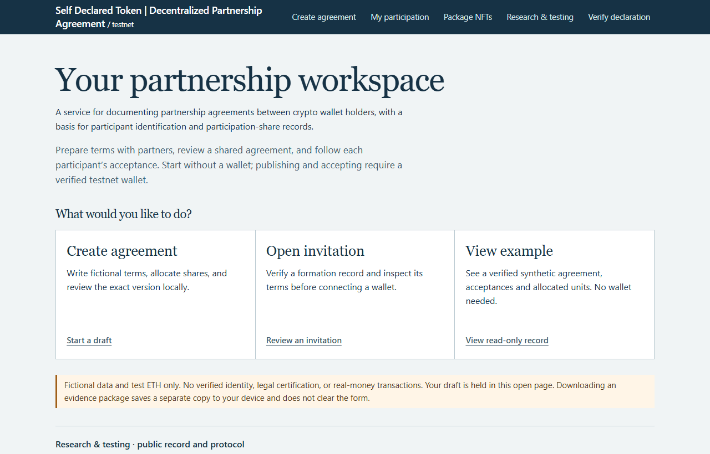

<div align="center">

# 🤝 DPA-SDT

   

**Document partnership agreements, connect self-declarations, and track ERC-721 participation packages.**

</div>

> A partnership workspace for crypto wallet holders: prepare shared terms, record individual acceptance, and preserve a basis for later attribution. Self-declarations support a documentary trail; they do not certify identity or legal rights.

<div align="center">
  <a href="#-quick-start">Quick Start</a> · <a href="#-features">Features</a> · <a href="#-tech-stack">Tech Stack</a> · <a href="#-roadmap">Roadmap</a>
  <br><br>
  
</div>

---

## 💡 Concept

A **Decentralized Partnership Agreement (DPA)** connects exact off-chain terms, named participant wallets, allocations, and individual EIP-712 acceptances. A **Self-Declared Token (SDT)** connects a wallet to a commitment over declared identity and banking-trace fields. After acceptance, the exclusive package route represents participation through ERC-721 NFTs.

Start by drafting and reviewing locally, without a wallet. Publishing and accepting require the appropriate testnet wallet and verified contract provenance. Keep the exact agreement document: its on-chain hash cannot recover lost text.

> [!NOTE]
> This private repository contains source and local research tooling. The existing [public website](https://maximosovsky.github.io/Decentralized-Partnership-Agreements-DPA-Self-Declared-Tokens-SDT/) is compiled output maintained in a separate repository. This checkout does not automatically publish that site or change the existing [Vercel test deployment](https://cryptopassport-testnet.vercel.app/). The preview above comes from this checkout's production build.

---

## ✨ Features

| Feature | What you can do |
| --- | --- |
| Agreement workspace | Draft terms and allocations locally, export exact evidence, and review invitations before connecting a wallet. |
| Self-declaration commitment | Compute domain-separated SHA-256 over thirteen exact identity and banking-trace fields in the browser. |
| Individual acceptance | Bind EOA EIP-712 signatures to the chain, contract, agreement, allocation, SDT, and nonce; retain immutable snapshots. |
| ERC-721 participation packages | Claim exclusive packages after complete acceptance, split without inflating quantity, and inspect package history. |
| Package experiments | Exercise sale, pledge, and funded test-ETH loan flows with contract and evidence checks. |
| Read-only declaration check | Compare thirteen original field strings with a historical acceptance snapshot; export JSON or HTML reports without a wallet. |

> [!WARNING]
> Creation and transaction experiments use fictional fixtures and test ETH only. The separate read-only verifier can process original field strings locally; RPC receives chain-record queries, not those strings. Reports omit the strings by default; explicitly including them creates a sensitive downloaded copy. Hash correspondence is not identity or bank verification, a legal guarantee, or proof of L1 finality. Public unsalted hashes are guessable, not encryption.

---

## 🚀 Quick Start

Requires **Node.js >=22.13**, npm, and authenticated access to this private repository. Verified with Node.js 26.7.0 and npm 11.19.0.

```bash
git clone https://github.com/maximosovsky/DPA-SDT.git
cd DPA-SDT/test-deployment
npm ci && npx playwright install chromium
npm run build
npm run dev -- --port 4173 --strictPort
```

Open **http://127.0.0.1:4173/**. No wallet, private key, or RPC credential is required to build the frontend. If port 4173 is occupied, select another free port rather than stopping an existing service.

<details>
<summary>🧪 Tests, compilation, and production build</summary>

Run from `test-deployment/` after installing dependencies and Chromium:

```bash
npm test
npm run test:hash
npm run build
```

- `npm test`: **234 passing / 0 failing**, including Chromium checks. Its `pretest` script builds fixtures automatically.
- `npm run test:hash`: **4 passing / 0 failing** for the thirteen-field v2 helper, including an independent SHA-256 vector.
- `npm run build`: compiles contracts, checks and installs six pinned deployed artifacts by SHA-256, then bundles the Vite frontend into `dist/`.
- `npm run compile`: standalone Solidity compilation.

These are local checks, not new public-chain transactions. Public-network deployment or transaction runners require separate authorization. Never use publicly known development accounts on a public network.

</details>

---

## 🏗️ Tech Stack

| Layer | Technology |
| --- | --- |
| Browser interface | TypeScript 5.9.3, Vite 7.3.7, HTML and CSS |
| EVM interaction and hashing | viem 2.57.6, SHA-256, EIP-712 |
| Contracts | Solidity 0.8.28, OpenZeppelin Contracts 5.4.0 |
| Local verification | Hardhat 3.19.0, node:test, Playwright 1.64.1 / Chromium |
| Research networks | Base Sepolia (84532); ephemeral local Hardhat (31337) |

<details>
<summary>📁 Project structure and supporting documents</summary>

```text
DPA-SDT/
|-- README.md, llms.txt, llms-full.txt
|-- PROVENANCE.md, snapshot-manifest.json
|-- VERIFICATION.md
|-- docs/preview.png
`-- test-deployment/
    |-- client/                 Browser UI and styles
    |-- src/                    Hashing, documents, evidence and provenance
    |-- contracts/              Solidity implementations
    |-- canonical-artifacts/    Six pinned deployed artifacts
    |-- test/, scripts/         Local tests and research runners
    |-- docs/                   Specifications and historical evidence
    |-- *.html                  Workspace, package, verifier and legal pages
    `-- package.json, package-lock.json
```

[Source README](test-deployment/README.md) · [Specification](test-deployment/docs/specification.md) · [Threat model](test-deployment/docs/threat-model.md) · [Test matrix](test-deployment/docs/test-matrix.md)

[PROVENANCE.md](PROVENANCE.md) and `snapshot-manifest.json` describe the original copied snapshot, not hashes of this later documentation revision. [VERIFICATION.md](VERIFICATION.md) retains historical results; current passing checks are listed above. Source-era documents may retain older names or workflow details.

Historical Base Sepolia records remain unchanged in [published-nine](test-deployment/docs/evidence/base-sepolia/published-nine/) and [exclusive-nft-package](test-deployment/docs/evidence/base-sepolia/exclusive-nft-package/). The final-nine manifest records nine scenarios and 31 distinct successful receipt hashes, with an explicit 31 raw / 30 lifecycle distinction. The recorded provider was a controlled Playwright EIP-1193 test-wallet adapter, not manual MetaMask. No fresh RPC receipt verification or historical scenario rerun is claimed here.

</details>

---

## 🗺️ Roadmap

This checklist records implemented scope, not a promise of future releases.

- [x] Local agreement drafting, invitation review, and individual acceptance.
- [x] Thirteen-field SDT v2 hashing and read-only historical declaration reports.
- [x] Exclusive ERC-721 package issuance, splitting, sale, pledge, and test-ETH loans.
- [x] Reproducible build and full local regression suite.

Pre-authenticated identification and contract-wallet acceptance are not implemented. No production or mainnet rollout is announced.

---

## 🤝 Contributing

With authorized access: **Fork → `feature/name` → PR**, or use an approved branch in this private repository. Describe the change and run local checks before review.

Do not commit credentials, original identity or bank data, sensitive reports, or signed raw transactions. Preserve exact document/evidence bytes, domain separators, and existing rights notices; do not relabel historical evidence as new execution.

---

## 📄 License

[Maxim Osovsky](https://www.linkedin.com/in/osovsky/). **No repository-wide license is granted:** the source has no `LICENSE` file, and this documentation update adds none. Contract SPDX `UNLICENSED` notices remain intact.

Existing site-content [CC BY 4.0](https://creativecommons.org/licenses/by/4.0/) attribution applies to its stated scope; it does not relicense contracts, research text, or third-party dependencies. Existing notices remain unchanged. Consult the rights holder before reuse outside applicable grants; this section is not legal advice.
